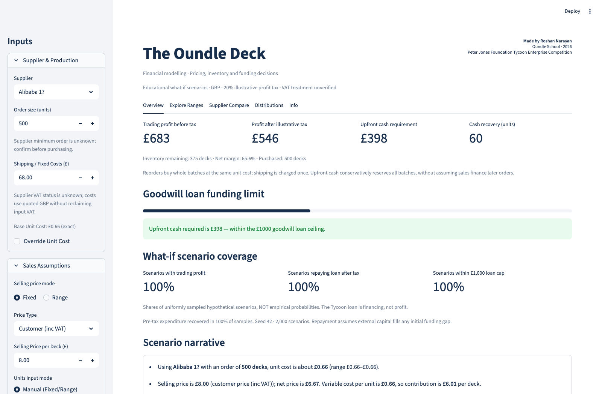
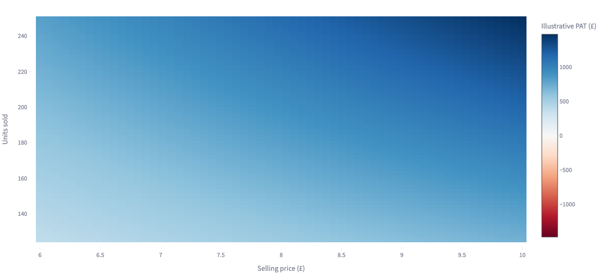
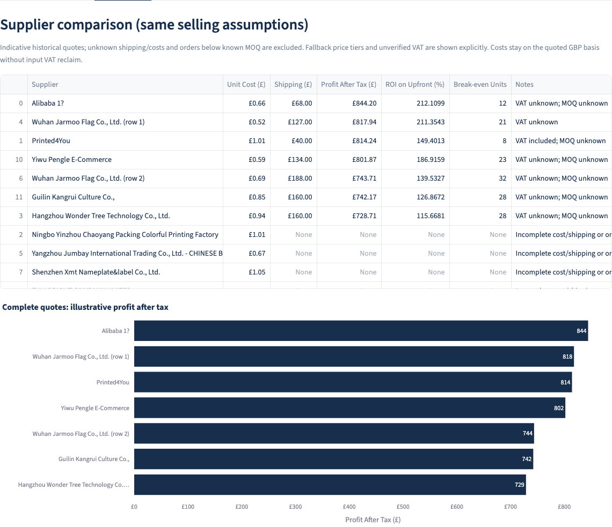

# The Oundle Deck — Financial Modelling Dashboard

**An interactive Python dashboard for pricing, supplier selection, inventory and startup funding decisions.**

Developed by **Roshan Narayan** for **The Oundle Deck**, an Oundle School branded
playing-card enterprise in the **2026 Peter Jones Foundation Tycoon Enterprise
Competition**.

> The six-person enterprise team won the **Key Stage 3–4 award**, selling
> approximately **350 decks** and generating approximately **£1,100 in revenue**.
> These are reported historical team outcomes, not calculated profit, model
> predictions or audited results. The dashboard is Roshan's individual software
> contribution to the wider team's business project.



## Why I built it

Choosing a supplier was more than comparing a price per deck. Minimum orders,
shipping, uncertain demand and a limited goodwill loan created competing choices:
a low unit cost could still mean too much cash tied up in unsold stock.

I built a decision-support tool to make those trade-offs visible. It compares
supplier and pricing assumptions, separates accounting profit from cash recovery,
and shows how conclusions change under different volumes and costs. It is an
educational scenario model, not the enterprise's full accounting system.

## What it does

| Area | Capabilities |
| --- | --- |
| Suppliers | Historical CSV quotes, manual supplier entry, purchase-cost overrides, missing-data warnings and MOQ checks |
| Sales and demand | Fixed/range prices and volumes, or a two-anchor assumed demand curve |
| Finance | Trading PBT, illustrative PAT, contribution, margins, inventory and upfront expenditure |
| Funding | Separate pre-tax cash recovery, loan repayment after illustrative tax, and external funding gap |
| Scenarios | All-corner manual extrema, price/cost profit bands, price × volume heatmaps and demand-linked sweeps |
| Risk | 2,000 seeded Monte Carlo samples showing hypothetical scenario shares |
| Communication | Interactive Plotly charts, a narrative summary, glossary and cash-limited charity/team allocations |

The **school-bill sales channel has no card-processing fees** in this model.
No AI model, external API key or customer personal data is used.

## Analytical views

These are screenshots of the actual running application with illustrative inputs.
They do not depict verified historical trading results.





## Technology and architecture

**Python · Streamlit · pandas · NumPy · Plotly · pytest · GitHub Actions**

```text
app/main.py                   Streamlit controls, narrative and interactive charts
model/
  __init__.py
  finance.py                  Validated finance inputs, inventory, cash and allocation
  quotes.py                   Supplier parsing and purchase-price selection
  demand.py                   Validated two-anchor demand interpolation
  scenarios.py                Sensitivity sweeps and scenario bounds
  risk.py                     Seeded Monte Carlo scenario coverage
data/
  quotes_clean.csv            Application data (13 historical supplier entries)
  quotes_original.csv         Retained pre-audit source CSV
docs/
  MODEL_ASSUMPTIONS.md         Financial definitions and limitations
  DATA_NOTES.md                Supplier-column corrections and provenance limits
assets/screenshots/           Genuine application captures
.streamlit/config.toml        Navy/white dashboard theme
.github/workflows/tests.yml   Python 3.11/3.12 checks
tests/                        Model regressions and Streamlit interaction smoke tests
```

The model modules contain calculations independently of Streamlit. The dashboard,
scenario sweeps and risk simulation use the same finance and inventory rules.

## Install and run

Use **Python 3.11 or 3.12** (3.12 recommended for deployment).

```bash
git clone https://github.com/roshigod98/Enterprise_financial_modelling.git
cd Enterprise_financial_modelling
python3 -m venv .venv
source .venv/bin/activate
python -m pip install -r requirements.txt
python -m streamlit run app/main.py
```

On Windows, use `python` to create the environment and activate with
`.venv\Scripts\Activate.ps1` in PowerShell instead of `source`.

Open the local URL printed by Streamlit. In PyCharm, select `.venv` as the project
interpreter and run the same commands in its terminal. Supplier edits made in the
app are session inputs; they do not update the CSV. Run commands from the project
root; data loading also resolves relative paths from the source directory.

## Financial assumptions and limitations

- **Goodwill loan ≠ revenue or trading profit.** Principal is tracked as repayable
  financing, with a £1,000 funding ceiling assumption and a visible external-capital gap.
- **Trading break-even** uses contribution to cover fixed costs. **Cash recovery**
  uses net sales receipts to recover the whole inventory order plus fixed expenditure,
  before tax. Inventory purchases are counted once.
- **20% profit tax is illustrative**, not confirmed UK liability. VAT registration
  and the school's actual financial treatment are unverified. Customer-price mode
  deducts an illustrative 20% output VAT; net-price mode does not. Purchase costs
  remain on their quoted GBP basis without assumed input VAT recovery.
- **Distributions require available cash** after illustrative tax, full loan repayment
  and external-capital recovery, capped by positive PAT. Defaults are 30% charity,
  then 45% CEO and 11% each to five members. They are not verified actual payouts.
- Sales respect purchased stock. Reorders buy whole batches at the same unit cost,
  reserve all purchases upfront and retain the original one-time shipping assumption.
  Timing, repeated delivery charges and tier changes require a fuller cashflow model.
- Missing shipping is **unknown**, not free. Incomplete quotes are excluded from
  rankings. Historical prices, landed costs and supplier identity need confirmation.
- Demand anchors and Monte Carlo ranges are chosen assumptions. Scenario percentages
  are **not calibrated probabilities**. Demand-linked bounds are sampled over 201 prices.

Read the full **[model assumptions](docs/MODEL_ASSUMPTIONS.md)** and
**[supplier data audit](docs/DATA_NOTES.md)** before interpreting the results.

## Testing and reproducibility

```bash
python -m pytest -q
python -m compileall -q app model
python -m pip check
```

Tests cover VAT conversions, trading profit and illustrative tax, loan exclusion,
cash recovery, inventory limits and reorders, nonpositive contribution, allocation
conservation and cash limits, supplier parsing/alignment, missing fields, demand,
collapsed ranges, scenario extrema, seeded risk consistency and Streamlit reruns.
Direct dependencies are pinned; Monte Carlo defaults to seed **42**. GitHub Actions
runs the suite and compilation on Python **3.11 and 3.12**. No browser download is
needed for the tests. Screenshot capture used a local browser, outside app dependencies.

## Streamlit Community Cloud

The entrypoint is **`app/main.py`**, with `requirements.txt` and `.streamlit/config.toml`
at the repository root. No secrets or external services are needed.

To publish from an authorised Streamlit account, create an app for
`roshigod98/Enterprise_financial_modelling`, choose branch **`main`**, enter
**`app/main.py`**, select **Python 3.12** under Advanced settings, then deploy.
Verify the overview, range/demand modes and supplier warnings before sharing the
assigned URL. See the [official deployment guide](https://docs.streamlit.io/deploy/streamlit-community-cloud/deploy-your-app/deploy).
No public app URL is claimed here until deployment has been verified.

## What I learned

The project connected Python development to a real enterprise decision. It made
the difference between financing, accounting profit and available cash concrete,
and showed why inventory and incomplete supplier data can change a decision.

Separating the model from the interface made those definitions testable. Auditing
negative-margin scenarios and malformed data also taught me that useful charts
need consistent assumptions, clear labels and reproducible calculations.

## Future improvements

- Compare forecasts with observed sales and calibrate demand from evidence.
- Model school-bill collection dates, repeat-shipping costs and staged reorders.
- Add dated quote provenance, landed-cost confirmation and explicit VAT regimes.
- Include inventory write-downs and alternative charity/allocation policies.

## Attribution and ownership

**Software:** Roshan Narayan · **Enterprise:** The Oundle Deck, six-person Oundle
School team (2026). Business achievements belong to the team; this repository
presents Roshan's modelling and software work. School and Foundation names are
used for context and attribution; this is not an official product of either.
No official logos are included. No separate open-source licence is granted.
